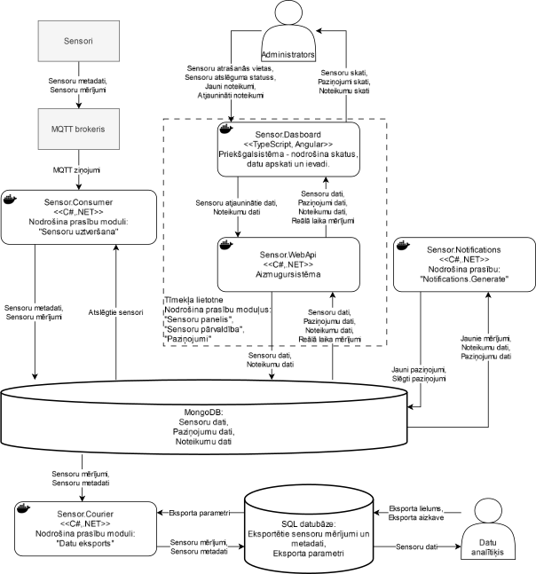
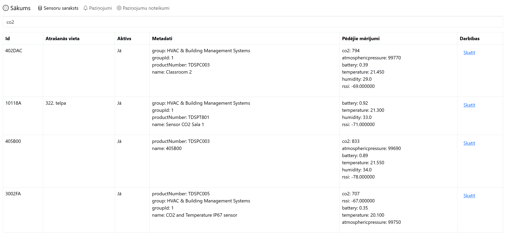
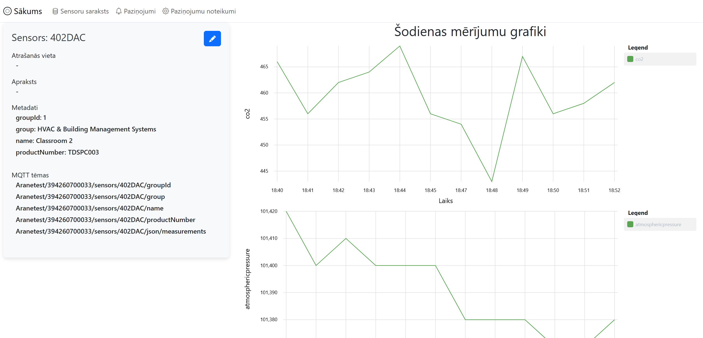
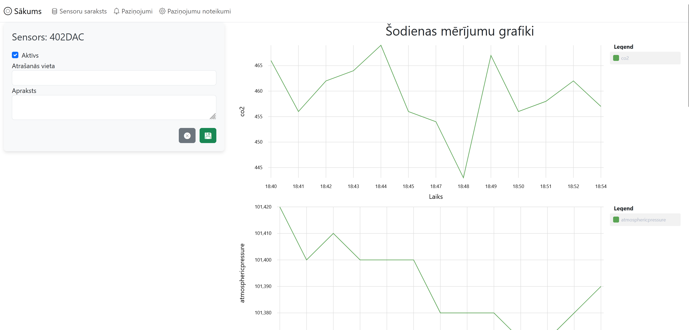
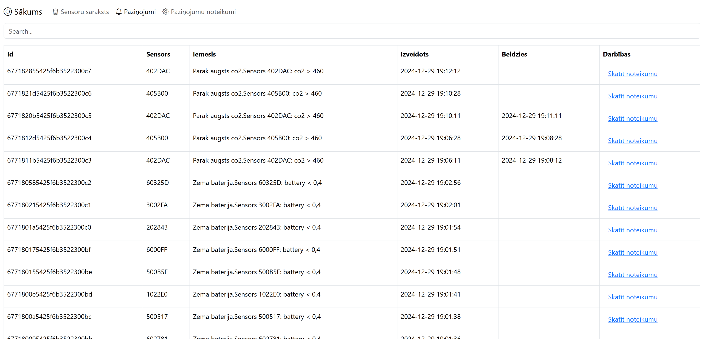
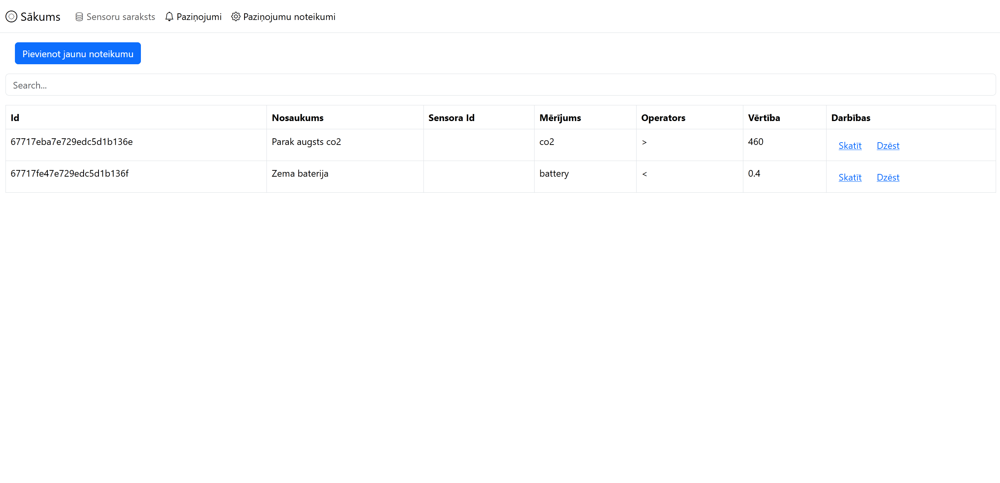
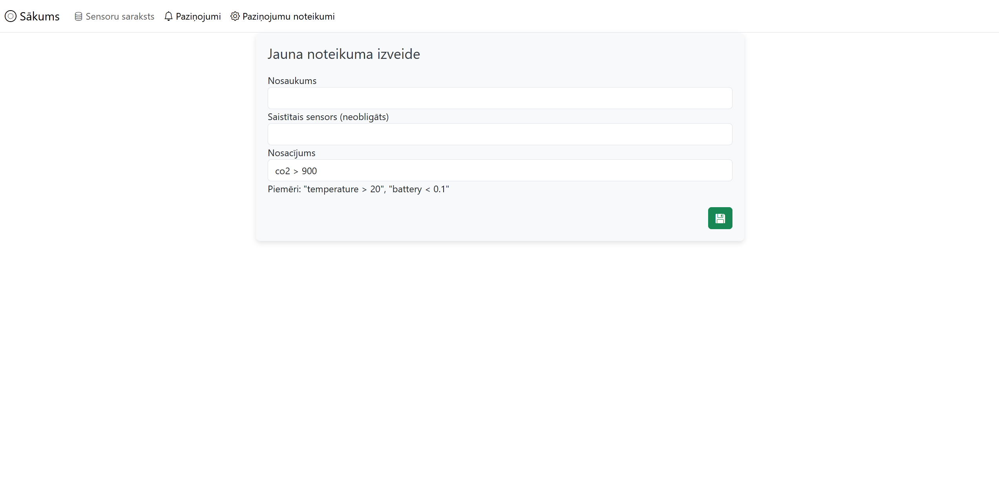
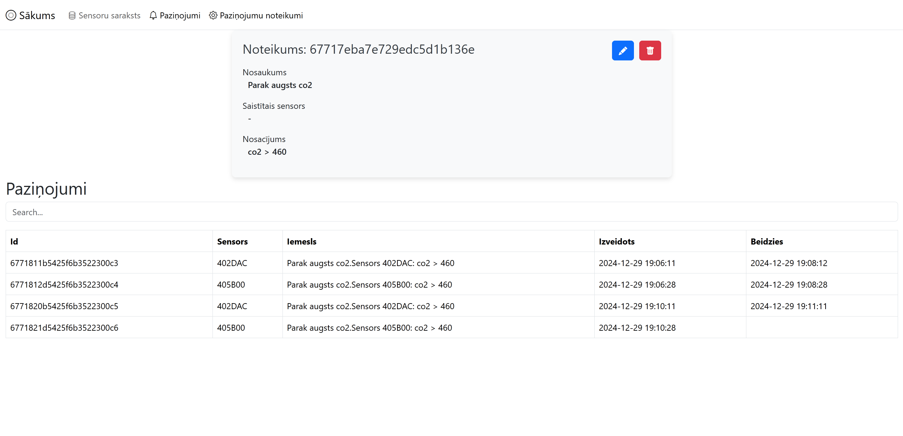
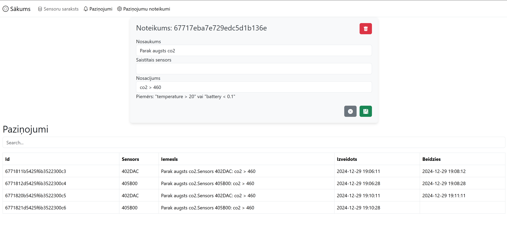

# Sensor Monitoring System

A real-time environmental sensor monitoring platform developed for Aranet sensors at the University of Latvia.

The system collects sensor measurements through MQTT, stores them in MongoDB, and provides an Angular web application for monitoring measurements, managing sensors, and configuring notification rules. It also supports exporting collected data to SQL databases for further analysis.

The platform was developed as a university qualification project and subsequently used to collect environmental sensor data for approximately one year.

**Technologies:** C#, .NET 8, Angular, TypeScript, MQTT, MongoDB, SignalR, SQL Server, MySQL, Docker

## Features

- **Real-time monitoring:** View sensor measurements through charts that automatically update as new data arrives.
- **Sensor management:** Browse, search, and manage registered sensors, including their locations and data collection status.
- **Notification system:** Define custom measurement thresholds and track violations without generating duplicate notifications.
- **Historical data:** Store and retrieve measurements and sensor metadata.
- **Data export:** Transfer measurements from MongoDB to SQL Server or MySQL for further analysis.
- **Containerized deployment:** Run the system's components independently using Docker.

## Architecture

The system uses a modular architecture consisting of independently running services. Each component has a separate code repository and can be deployed as a Docker container.

Sensor measurements are received through an MQTT broker and stored in MongoDB. The backend exposes sensor data to the Angular application and uses SignalR to deliver real-time updates.

A separate notification service evaluates incoming measurements against configured rules, while a data export service transfers measurements to relational databases.

### Components

| Component | Responsibility |
|---|---|
| [Sensor Consumer](https://github.com/Markuss-B/sensor-consumer) | Receives and processes MQTT sensor measurements and metadata, storing them in MongoDB |
| [Sensor Web API](https://github.com/Markuss-B/sensor-webapi) | Provides REST endpoints for sensor and notification management and real-time updates through SignalR |
| [Sensor Dashboard](https://github.com/Markuss-B/sensor-dashboard) | Angular web application for viewing measurements, managing sensors, and configuring notifications |
| [Sensor Notifications](https://github.com/Markuss-B/sensor-notifications) | Evaluates measurement-based notification rules and tracks active and resolved violations |
| [Sensor Courier](https://github.com/Markuss-B/sensor-courier) | Exports measurements from MongoDB to SQL Server or MySQL |

Each component repository contains its own implementation details and configuration instructions.

## Web Application

The Angular dashboard provides a centralized interface for monitoring environmental sensors and managing notifications.

The interface is in Latvian; English descriptions are provided alongside the screenshots.

### Sensor Overview

Browse and search registered sensors, including their current status and latest measurements.

The sensor overview displays all registered sensors in a searchable table.

Each row includes:

- **Sensor ID:** The unique identifier of the sensor.
- **Location:** The sensor's location, assigned by an administrator.
- **Active status:** Whether data collection is enabled for the sensor.
- **Metadata:** Information provided by the sensor itself.
- **Latest measurements:** The most recently collected measurement values.
- **View action:** Opens the sensor's detailed monitoring page.

The search field allows users to quickly locate a sensor.

### Real-Time Sensor Monitoring

Inspect an individual sensor's metadata and measurement history through automatically updating charts.

The sensor details page displays information about the selected sensor, including its metadata and today's measurements.

Each measurement type is displayed in a separate time-series chart. New readings are delivered through SignalR and added to the charts automatically without refreshing the page.

Administrators can also update the sensor's location and enable or disable data collection.

Sensor editing interface

The editing interface allows administrators to modify the sensor's assigned location and active status.

### Notifications

View notifications generated by sensor measurements that satisfy configured notification rules.

The notification overview provides a searchable table of generated notifications.

Each notification includes:

- **Related sensor:** The sensor responsible for triggering the notification.
- **Reason:** The condition that triggered the notification, such as elevated CO₂ concentration.
- **Start time:** When the condition was first detected.
- **End time:** When the condition was no longer satisfied.
- **View rule:** Opens the rule responsible for generating the notification.

Notifications are displayed from newest to oldest and can be filtered using a search phrase.

A notification remains active while its triggering condition persists. This prevents repeated notifications for the same ongoing event and allows the system to record when the condition started and ended.

### Notification Rules

Create and manage custom rules that generate notifications based on sensor measurements.

The rule management page lists configured notification rules. Administrators can view individual rules, create new ones, edit existing rules, or delete them after confirmation.

#### Creating a Rule

The rule creation form allows administrators to configure:

- **Name:** A descriptive name for the rule.
- **Target sensor:** A specific sensor or all registered sensors.
- **Measurement:** The measurement type to monitor, such as CO₂ concentration.
- **Comparison operator:** Greater than (`>`) or less than (`<`).
- **Threshold:** The value against which measurements are compared.

For example, the rule:

`co2 > 1000`

generates a notification when a sensor's CO₂ measurement exceeds 1000.

After creating a rule, the application redirects the administrator to its details page.

#### Viewing and Editing Rules

The rule details page displays the configured condition and a list of notifications associated with that rule, ordered from newest to oldest.

Rule editing interface

Administrators can modify an existing rule's configuration.

## Engineering Highlights

The project incorporates several engineering practices and technologies:

- **Asynchronous data processing:** Incoming MQTT measurements are processed asynchronously by a .NET background service.
- **Event-driven updates:** MongoDB Change Streams allow components to react to newly stored measurements and changes in sensor status.
- **Real-time communication:** SignalR delivers measurements to subscribed dashboard clients.
- **Flexible data storage:** MongoDB supports sensor measurements and metadata with varying structures.
- **Stateful notifications:** Notification lifecycles are tracked to prevent duplicate alerts during continuous threshold violations.
- **Modular architecture:** Components run independently in Docker containers with environment-specific configurations.

Implementation details are documented in the corresponding component repositories.

## Deployment

The system was deployed on a University of Latvia server using Docker containers.

The deployment includes the application services, a Mosquitto MQTT broker, MongoDB, and an Nginx-hosted Angular dashboard.

Each service is configured independently, allowing components to be deployed and maintained separately.

Local Docker configuration files are available in the [`.build`](.build/) directory.

## Project Outcomes

The platform was developed as a qualification project at the University of Latvia and received a grade of 10/10.

Following development, the system was used for approximately one year to collect environmental sensor measurements.

The project demonstrates the integration of real-time data ingestion, backend services, database storage, web development, notification processing, and containerized deployment into a functioning monitoring system.

## Documents

- [Project presentation](Presentation.pdf)
- [Qualification paper](paper.pdf)
